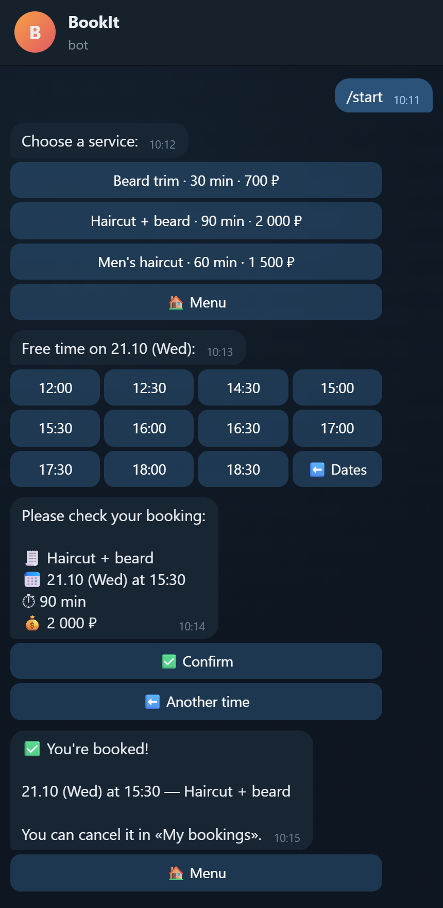
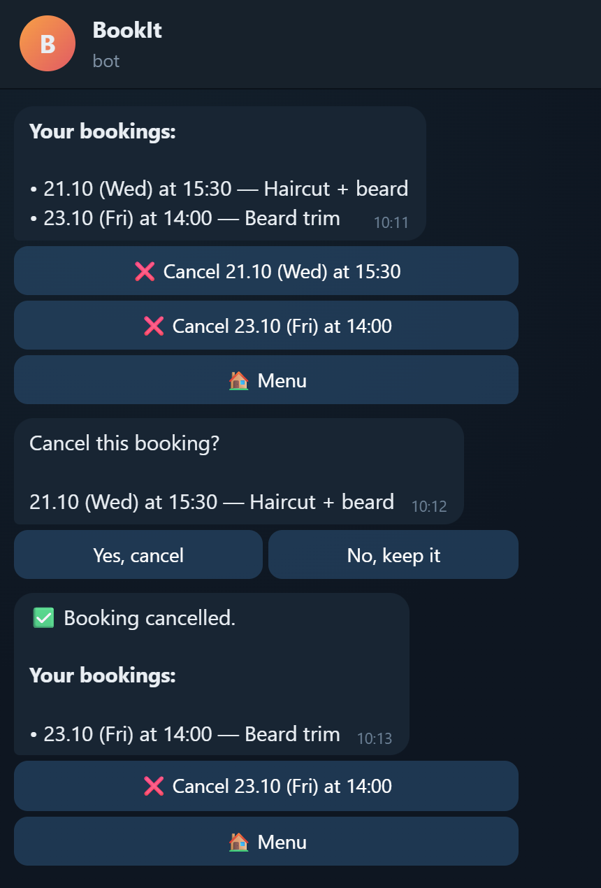
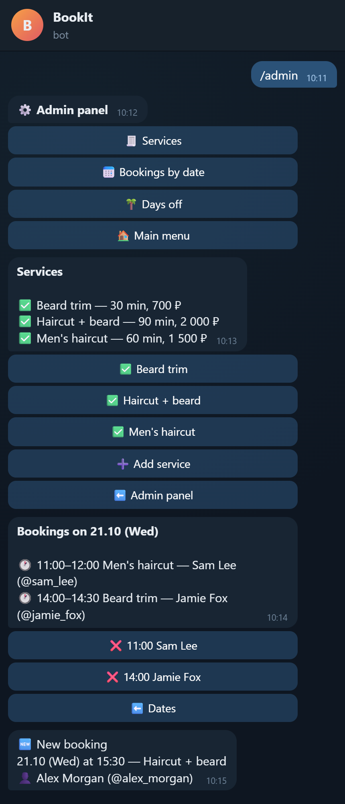

# BookIt — Telegram bot for booking appointments

**English** | [Русский](README.ru.md)

[](https://github.com/born2feel/bookit/actions/workflows/ci.yml)


A booking bot for a small single-master business: a barbershop, a tutor, a massage therapist.
Clients pick a service, a date and a free time slot. The administrator manages services,
bookings and days off right inside Telegram. The interface is available in **English and Russian**.

## Screenshots

| Client booking | My bookings | Admin panel |
|:---:|:---:|:---:|
|  |  |  |

> Rendered from the bot's real responses: the actual handlers were driven through aiogram's `Dispatcher` and their messages and keyboards were captured.

## Features

**Client**
- 📅 Step-by-step booking: service → date → free slot → confirmation with the price
- 📋 «My bookings»: upcoming appointments, cancellation in two taps
- 🔒 The bot does not allow booking in the past, on a day off, or a time that is already taken
- 🌐 Language selection (🇬🇧 English / 🇷🇺 Русский). On the first visit the language comes from the Telegram settings, later the user switches it with the button or `/language`.

**Administrator** (`/admin`, access via `ADMIN_IDS`)
- 🧾 Services: add, change price and duration, hide from the catalog
- 📅 Bookings for any date, with cancellation (the client gets notified)
- 🌴 Days off. The bot won't close a day that already has bookings.
- 🔔 Notifications about new bookings and cancellations, each one in the recipient's own language

## Tech stack

| Area | Technology |
|---|---|
| Bot | Python 3.12, **aiogram 3** (routers, FSM, middlewares, CallbackData) |
| Database | **SQLAlchemy 2** (async), **Alembic**; SQLite locally, PostgreSQL in Docker |
| Config | pydantic-settings |
| Tests | pytest, pytest-asyncio |
| Code quality | ruff (lint + format) |
| Infrastructure | Docker, docker-compose, GitHub Actions |

## Architecture

```
Telegram ──► handlers ──► services ──► repositories ──► DB
             (aiogram)    (logic)      (SQLAlchemy)
```

- **handlers** (`bot/handlers`): receive updates, call services and render the response. They never touch the database directly.
- **services** (`services/`): all business logic: slot calculation, booking and cancellation rules, validation. The layer doesn't depend on the language. Domain errors (`BookItError`) carry a translation key and parameters, and the bot layer turns them into text.
- **repositories** (`repositories/`): SQL queries only, no business rules.
- **middleware** opens a DB session per update and injects services, the translator (`tr`) in the user's language and the notifier into handlers via aiogram DI.
- **Error handling** lives in one place: domain errors are shown to the user as clear messages in their language. Unexpected errors are logged, and the user sees a neutral message.

### Notable decisions
- **Slot calculation** is a pure function `compute_free_slots`: working hours, slot grid step, service duration, overlap of half-open intervals `[start, end)`, cut-off of past time.
- **Double-booking protection on two levels.** `asyncio.Lock` makes check-and-insert atomic (aiogram processes updates concurrently). A partial unique index `start_at WHERE status = 'active'` in the DB works in both SQLite and PostgreSQL.
- **Time** is stored in UTC: the custom `UTCDateTime` type aligns SQLite and PostgreSQL behavior. Time is displayed in the business timezone.
- **Dependency-free i18n:** message dictionaries `bot/i18n/{ru,en}.py`. Tests check that both languages have the same keys and placeholders, and that every key used in the code exists.
- **Injectable clock** (`clock`) in services keeps tests deterministic.

### Project layout
```
src/bookit/
├── __main__.py        # entry point
├── config.py          # settings from the environment
├── db/                # models, base class, sessions
├── repositories/      # data access
├── services/          # business logic + domain exceptions
└── bot/
    ├── handlers/      # common, client, admin, errors, fallback
    ├── keyboards/     # inline keyboards
    ├── i18n/          # translations ru / en + Translator
    ├── callbacks.py   # CallbackData factories
    ├── states.py      # FSM
    ├── middlewares.py # DB session + DI
    ├── filters.py     # IsAdmin
    └── notifier.py    # notifications
migrations/            # Alembic
tests/                 # tests
```

### Data model
- **User**: Telegram user and their interface language
- **Service**: name, duration, price, active flag
- **Booking**: client, service, start, end, status `active`/`cancelled`
- **DayOff**: a day off

## Running locally

Requires Python 3.12+.

```bash
git clone https://github.com/born2feel/bookit.git
cd bookit
python -m venv .venv
source .venv/bin/activate        # Windows: .venv\Scripts\activate
pip install -e ".[dev]"
cp .env.example .env             # fill in BOT_TOKEN and ADMIN_IDS
alembic upgrade head
python -m bookit
```

## Running with Docker

```bash
cp .env.example .env             # fill in BOT_TOKEN, ADMIN_IDS, POSTGRES_PASSWORD
docker compose up --build -d
docker compose logs -f bot
```

This starts PostgreSQL and the bot. Migrations are applied automatically when the container starts.

## Configuration

| Variable | Default | Description |
|---|---|---|
| `BOT_TOKEN` | (required) | token from @BotFather |
| `ADMIN_IDS` | (empty) | admin Telegram IDs, comma-separated |
| `DATABASE_URL` | `sqlite+aiosqlite:///./bookit.db` | SQLAlchemy connection string |
| `TIMEZONE` | `Europe/Moscow` | business timezone |
| `WORK_START` / `WORK_END` | `10:00` / `20:00` | working hours |
| `SLOT_STEP_MINUTES` | `30` | slot grid step |
| `BOOKING_HORIZON_DAYS` | `14` | how many days ahead booking is open |
| `LOG_LEVEL` | `INFO` | logging level |

## Tests and linting

```bash
pytest
ruff check .
ruff format --check .
```

Tests cover the services layer: slot calculation, creating and cancelling bookings, the catalog,
days off, user languages, input validation and config. Separate tests check the translation
catalogs. Each test runs on its own in-memory SQLite database.
CI (GitHub Actions) runs the linter, the formatter check, the tests and a check that migrations
match the models (`alembic check`) on every push and PR.

## Limitations

- Single master: one schedule shared by all services.
- FSM state lives in memory (`MemoryStorage`), so unfinished flows are reset on restart.
- The booking lock works within a single bot process. That's fine for long polling,
  where the bot always runs as one instance.

## Security

Secrets are read only from environment variables; `.env` is git- and docker-ignored.
Admin handlers are protected by a filter, user input is HTML-escaped, the container runs as non-root,
and Dependabot keeps dependencies fresh. See [SECURITY.md](SECURITY.md) for how to report a vulnerability.

## License

[MIT](LICENSE) © [born2feel](https://github.com/born2feel)
